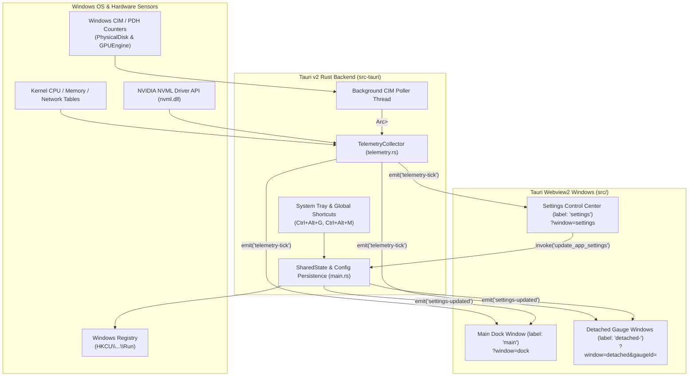

# PowerGauge HUD — Architecture & Developer Guide

This document details the internal architecture, hardware telemetry pipeline, multi-window management, and IPC contracts of **PowerGauge HUD**.

---

## 1. High-Level System Architecture

PowerGauge HUD is a **Tauri v2** application combining a native **Rust** backend with a **React 19 + TypeScript + SVG** frontend. All window views (`main` dock, `detached-<id>` single-gauge windows, and `settings` control center) are served from the same compiled single-page bundle (`index.html`), routed via URL query parameters (`?window=dock`, `?window=detached&gaugeId=...`, `?window=settings`).

---

## 2. Rust Hardware Telemetry Engine (`src-tauri/src/telemetry.rs`)

The `TelemetryCollector` struct aggregates hardware metrics from three complementary sources so that sampling remains fast (`250ms`–`2000ms`) and never blocks the main UI thread:

### 2.1 `sysinfo` Crate (Fast In-Process Sampling)
On every tick (`TelemetryCollector::sample()`):
- **CPU (`collect_cpu`)**: Calls `sys.refresh_cpu_all()`, reading global CPU usage %, per-core usage %, clock frequency (`MHz`), processor brand string, physical/logical core counts, process count, and CPU temperature from `sysinfo::Components`.
- **Memory (`collect_memory`)**: Calls `sys.refresh_memory()`, computing physical RAM usage %, used/total/available `GB`, and Swap/Pagefile usage.
- **Logical Disks (`collect_disks`)**: Calls `disks.refresh(true)` to obtain partition capacities (`usedGb`, `totalGb`, `usedSpacePercent`) and mount points (`C:\`, `D:\`).
- **Networks (`collect_networks`)**: Calls `networks.refresh(true)`, computes exact byte-per-second deltas (`downloadBytesPerSec`, `uploadBytesPerSec`) divided by elapsed `dt`, filters out pseudo/loopback interfaces, prioritizes Ethernet adapters, and updates a rolling exponential-decay peak bandwidth ceiling (`net_peak_bps`) with a `5 MB/s` minimum floor for smooth auto-scaling.

### 2.2 NVIDIA Management Library (`nvml-wrapper`)
- Initialized once via `Nvml::init().ok()`.
- Queries all installed NVIDIA GPUs directly via `nvml.dll` for:
  - Core utilization % (`utilization_rates().gpu`)
  - Dedicated VRAM used & total bytes (`memory_info()`)
  - Die temperature °C (`TemperatureSensor::Gpu`)
  - Fan speed % (`fan_speed(0)`)
  - Board power draw in Watts (`power_usage() / 1000.0`)
  - Graphics shader/core clock in MHz (`Clock::Graphics`)

### 2.3 Asynchronous Windows CIM / Performance Counter Poller (`spawn_windows_perf_poller`)
Because Windows Task Manager's **Physical Disk (`DISK 0`, `DISK 1`) Active Time %** and non-NVIDIA **DXGI GPU Utilization** come from Windows Performance Counters (`Win32_PerfFormattedData_PerfDisk_PhysicalDisk`, `Win32_PerfFormattedData_GPUPerformanceCounters_GPUEngine`, `Win32_PerfFormattedData_GPUPerformanceCounters_GPUAdapterMemory`, and `Win32_VideoController`), a dedicated background thread polls these counters without blocking the high-frequency telemetry loop and updates an `Arc<Mutex<WinPerfSidecarData>>` cache:
- Maps physical disks (`0 C:`, `1 D:`) to `disk-0`, `disk-1` with `% Disk Time`, `DiskReadBytesPersec`, `DiskWriteBytesPersec`, and aggregated partition capacities.
- Supplements or provides fallback `GPU 0..N` entries for AMD, Intel, and integrated GPUs.

---

## 3. Multi-Window Management & IPC Protocol (`src-tauri/src/main.rs`)

### 3.1 Window Labels & URL Routing
| Window Label | URL Route | Window Attributes | Purpose |
| :--- | :--- | :--- | :--- |
| `main` | `index.html` (default `window=dock`) | `transparent: true`, `decorations: false`, `alwaysOnTop: true` | Primary floating dock hosting all enabled, non-detached gauges. |
| `detached-<gaugeId>` | `index.html?window=detached&gaugeId=<id>` | `transparent: true`, `decorations: false`, `skipTaskbar: true`, `210x255` | Torn-off floating window for a single gauge (`cpu`, `disk-0`, `gpu-0`, etc.). |
| `settings` | `index.html?window=settings` | `decorations: true`, `transparent: false`, `880x660` | Standalone Control Center & Settings window. |

### 3.2 Tauri Commands (`invoke`)
| Command | Arguments | Return Type | Description |
| :--- | :--- | :--- | :--- |
| `get_telemetry_snapshot` | None | `SystemTelemetry` | Returns an immediate hardware telemetry sample. |
| `get_app_settings` | None | `Option<Value>` | Loads persisted `AppSettings` JSON from `power_gauge_settings.json`. |
| `update_app_settings` | `{ settings: Value }` | `()` | Saves settings to disk, applies window z-order/taskbar/ghost/autostart states, and broadcasts `settings-updated` to all windows. |
| `set_ghost_mode` | `{ enabled: bool }` | `()` | Toggles `set_ignore_cursor_events(enabled)` on `main` and all `detached-*` windows. |
| `detach_gauge_window` | `{ gaugeId: String, title: String }` | `()` | Spawns or focuses the frameless window `detached-<gaugeId>`. |
| `dock_gauge_window` | `{ gaugeId: String }` | `()` | Closes `detached-<gaugeId>` so the gauge returns to the `main` dock. |
| `dock_all_gauges` | None | `()` | Closes all `detached-*` windows and resets `detached: false` for all gauges. |
| `open_settings_window` | None | `()` | Spawns or focuses the `settings` Control Center window. |

### 3.3 Tauri Broadcast Events (`emit` / `listen`)
- **`telemetry-tick`** (`Payload: SystemTelemetry`): Broadcast by the Rust background loop every `polling_interval_ms` (`250ms`–`2000ms`) to all open windows.
- **`settings-updated`** (`Payload: AppSettings`): Broadcast whenever settings are changed from the Control Center, HUD toolbar, System Tray menu, or global hotkeys so all windows update instantaneously.
- **`reset-peaks`** (`Payload: {}`): Broadcast to clear high-water peak markers across all open gauge windows.

---

## 4. Frontend Rendering Pipeline (`src/`)

1. **`src/utils/telemetryAdapter.ts` (`buildNormalizedGauges`)**:
   - Transforms a raw `SystemTelemetry` snapshot + `AppSettings` + rolling `peaks` and `histories` maps into an array of `NormalizedGaugeData` items.
   - Applies per-gauge overrides (`styleOverride`, `scaleOverride`, `accentColor`, `diskMode`, `netScaleMode`).
   - Computes dynamic warning and critical/redline threshold colors based on the active theme preset (`cyber-cyan`, `tach-redline`, `emerald-matrix`, `solar-amber`, `violet-plasma`).
2. **`src/components/GaugeWidget.tsx`**:
   - Stateless, pure SVG + CSS hardware gauge renderer supporting all 4 visual styles:
     - `RadialArcGauge`: 270° SVG arc geometry (`describeArc`, `polarToCartesian`) with SVG `<feGaussianBlur>` neon filter and concentric inner secondary arc.
     - `TachometerGauge`: 50-subdivision analog dial scale, redline arc, primary/secondary sweeping needles, and dashed peak-hold needle.
     - `MinimalRingGauge`: Dual concentric 360° `<circle>` progress rings using `stroke-dasharray` / `stroke-dashoffset`.
     - `LedBarGauge`: 20-cell CSS Grid segmented power bar with threshold color zones and auxiliary sub-bar.
   - Renders `SparklineStrip` (40-point SVG `<polygon>` + `<polyline>`) and 3 sub-metric badges.

---

## 5. Configuration Storage & Windows Startup

- **Settings File Location**:
  Stored automatically via `app.path().app_config_dir()` at:
  `%APPDATA%\com.powergauge.hud\power_gauge_settings.json`
- **Windows Startup Integration**:
  Controlled by `apply_windows_autostart(enable: bool)` in `src-tauri/src/main.rs`, which writes or removes the `PowerGaugeHUD` string value under:
  `HKEY_CURRENT_USER\Software\Microsoft\Windows\CurrentVersion\Run`

---

## 6. How to Add a New Gauge Style or Sensor

### Adding a New Gauge Visual Style
1. Add the style identifier to `GaugeStyle` in [`src/types.ts`](../src/types.ts).
2. Implement the sub-component in [`src/components/GaugeWidget.tsx`](../src/components/GaugeWidget.tsx) accepting `{ data: NormalizedGaugeData, activeColor: string, settings: AppSettings }` and add it to `STYLE_ORDER` and the stage switch.
3. Add the style card to `SettingsModal.tsx` under the **Global Power Gauge Style** selector and per-gauge `<select>` dropdown.

### Adding a New Hardware Sensor Category
1. Add the Rust struct to [`src-tauri/src/telemetry.rs`](../src-tauri/src/telemetry.rs) and include it in `SystemTelemetry`.
2. Add the matching TypeScript interface in [`src/types.ts`](../src/types.ts).
3. Map the sensor into a `NormalizedGaugeData` entry inside `buildNormalizedGauges()` in [`src/utils/telemetryAdapter.ts`](../src/utils/telemetryAdapter.ts).
