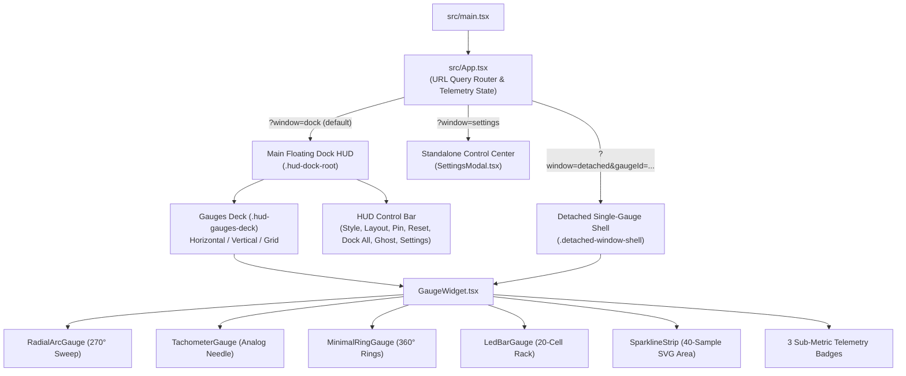

# Frontend Components, SVG Geometry & Styling Guide

This document covers the internal structure of the React/TypeScript frontend (`src/`), the SVG mathematics behind the 4 power gauge styles, the theme system, and the CSS layout architecture.

---

## 1. Component Hierarchy

---

## 2. SVG Gauge Geometry & Math (`src/components/GaugeWidget.tsx`)

All dial-based gauges (`radial`, `tachometer`, `ring`) render inside a responsive `<svg viewBox="0 0 160 148">` container using polar-to-Cartesian trigonometry:

$$x = c_x + r \cdot \cos\left(\frac{\theta \cdot \pi}{180}\right), \quad y = c_y + r \cdot \sin\left(\frac{\theta \cdot \pi}{180}\right)$$

### 2.1 `RadialArcGauge` (`style: "radial"`)
- **Center & Radii**: `(cx, cy) = (80, 80)`, Outer Arc `rOuter = 62`, Inner Concentric Arc `rInner = 50`.
- **Sweep Angles**: Starts at `135°` (bottom-left, 7:30 o'clock) and sweeps `270°` clockwise to `405°` (`45°`, bottom-right, 4:30 o'clock).
- **Value Angle Mapping**:
  $$\theta_{\text{val}} = 135^\circ + \frac{270^\circ \cdot \text{pct}}{100}$$
- **Outer Ticks**: 28 radial ticks (`i = 0..27`), with major ticks every 3 steps (`i % 3 === 0`). Ticks where `tPct >= warningThreshold` or `criticalThreshold` automatically tint amber/red.
- **Neon Glow Filter**: Uses `<filter id="glow-<gaugeId>">` with `<feGaussianBlur stdDeviation="3.2" />` merged over the active stroke path.
- **Peak-Hold Marker**: Draws a high-contrast radial tick line from `rOuter - 6` to `rOuter + 6` at $\theta_{\text{peak}}$.

### 2.2 `TachometerGauge` (`style: "tachometer"`)
- **Center & Radius**: `(cx, cy) = (80, 82)`, Dial Bezel `r = 62`.
- **Scale & Subdivisions**: 50 tick subdivisions (`2%` per minor tick) across the `270°` sweep (`135°` to `405°`), with numbered major ticks (`0, 1, 2, ... 10` representing `0%` to `100%`) every 5 steps (`10%`).
- **Redline Zone Arc**: Highlighted thick arc from $\theta_{\text{red}} = 135^\circ + 2.7^\circ \times \text{criticalThreshold}$ to $405^\circ$.
- **Needles**:
  - **Primary Needle**: Extends from tail (`r = 12` at $\theta + 180^\circ$) through center pivot `(80, 82)` to tip (`r = 54` at $\theta_{\text{val}}$).
  - **Secondary Needle (`data.isDualMode`)**: Renders a `#38bdf8` inner needle (`r = 44`) for Dual-Needle Network (`Download` + `Upload`) or Split Disk (`Active %` + `Used Space %`).
  - **Peak-Hold Ghost Needle**: Dashed amber needle (`strokeDasharray="3 2"`) holding the highest recent angle $\theta_{\text{peak}}$.
- **LCD Odometer Box**: Positioned at the bottom of the bezel (`bottom: 4px`) displaying `primaryText` + `primaryUnit` in monospace font.

### 2.3 `MinimalRingGauge` (`style: "ring"`)
- **Center & Radii**: `(cx, cy) = (80, 74)`, Outer Ring `rOuter = 56` ($C_{\text{outer}} = 2\pi r \approx 351.86$), Inner Ring `rInner = 45` ($C_{\text{inner}} \approx 282.74$).
- **Stroke Offset Animation**: Rotated `-90°` so `0%` begins at 12 o'clock:
  $$\text{strokeDashoffset} = C \cdot \left(1 - \frac{\text{pct}}{100}\right)$$
- **Peak Dot**: Small `<circle r="3.8">` positioned on the outer ring circumference at $\theta_{\text{peak}} = -90^\circ + 3.6^\circ \times \text{peakPct}$.

### 2.4 `LedBarGauge` (`style: "led-bar"`)
- **Primary Rack**: 20-column CSS Grid (`grid-template-columns: repeat(20, 1fr)`).
- **Segment Illumination**: Cell `i` (`0..19`) lights up when `i < Math.round((pct / 100) * 20)`.
- **Zone Coloring**: Each lit cell computes its own percentage `segPct = ((i + 1) / 20) * 100` and colors itself using `activeColor` (normal), `palette.warning` (`>= warningThreshold`), or `palette.critical` (`>= criticalThreshold`) with a matching `box-shadow` glow.
- **Peak Cell**: Cell `Math.floor((peakPct / 100) * 20)` renders bright white (`#ffffff`) even after load drops.
- **Secondary Auxiliary Rack**: When `secondaryPercent !== null`, a 20-cell compact strip renders directly underneath for VRAM / Swap / Disk Space / Upload.

---

## 3. Theme Presets & Dynamic Color Thresholds (`src/utils/telemetryAdapter.ts`)

Five built-in palettes are defined in `THEME_ACCENTS`:

| Theme Preset | `cpu` | `memory` | `disk` | `network` | `gpu` | `warning` | `critical` |
| :--- | :--- | :--- | :--- | :--- | :--- | :--- | :--- |
| **`cyber-cyan`** | `#00f0ff` | `#a855f7` | `#3b82f6` | `#10b981` | `#f43f5e` | `#f59e0b` | `#ef4444` |
| **`tach-redline`** | `#f97316` | `#eab308` | `#38bdf8` | `#22c55e` | `#ef4444` | `#fb923c` | `#dc2626` |
| **`emerald-matrix`** | `#10b981` | `#34d399` | `#06b6d4` | `#84cc16` | `#22d3ee` | `#facc15` | `#f43f5e` |
| **`solar-amber`** | `#f59e0b` | `#fbbf24` | `#fb923c` | `#38bdf8` | `#f43f5e` | `#f97316` | `#ef4444` |
| **`violet-plasma`** | `#c084fc` | `#818cf8` | `#38bdf8` | `#2dd4bf` | `#f472b6` | `#fbbf24` | `#fb7185` |

### Dynamic Color Resolution (`getDynamicColor` in `GaugeWidget.tsx`)
1. Base color is `config.accentColor || palette[category]`.
2. If `primaryPercent >= settings.criticalThreshold` (default `88%`), `activeColor` switches to `palette.critical` and `.gauge-card` gains the `.is-redline` border glow class.
3. Else if `primaryPercent >= settings.warningThreshold` (default `72%`), `activeColor` switches to `palette.warning`.

---

## 4. CSS Custom Properties & Layout Scaling (`src/styles.css`)

- **Root & Card CSS Variables**:
  - `--hud-bg-alpha`: Controlled by `settings.backgroundOpacity` (`0.0` to `1.0`), adjusting the alpha channel of both `.hud-dock-root` and `.gauge-card`.
  - `--grid-cols`: Controlled by `settings.gridColumns` (`2` to `6`), driving `.hud-gauges-deck.layout-grid`.
  - `--gauge-accent`: Active dynamic hex color for the card hover border and status dot.
- **Scale Classes**:
  - `.gauge-card.scale-mini`: `width: 154px`, compact stage (`98px` min-height), `18px` readout font.
  - `.gauge-card.scale-standard`: `width: 192px`, standard stage (`122px` min-height), `23px` readout font.
  - `.gauge-card.scale-large`: `width: 236px`, expanded stage (`152px` min-height), `28px` readout font.
  - `.gauge-card.is-detached-card`: `width: 100%; height: 100%` so torn-off gauge windows fill their resizable floating frame cleanly.
