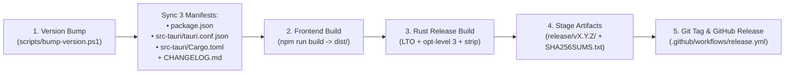

# Release Engineering & Packaging Guide

This document describes the complete release lifecycle for **PowerGauge HUD**, including semantic version synchronization, local release staging, Windows installer generation (`.exe` NSIS & `.msi` WiX), SHA-256 checksum verification, and automated GitHub Actions CI/CD publishing.

---

## 1. Release Architecture Overview



---

## 2. Version Parity Invariant

In a Tauri v2 application, the semantic version (`X.Y.Z`) lives in **three** files that must always match:
1. [`package.json`](../package.json) (`"version": "X.Y.Z"`)
2. [`src-tauri/tauri.conf.json`](../src-tauri/tauri.conf.json) (`"version": "X.Y.Z"`)
3. [`src-tauri/Cargo.toml`](../src-tauri/Cargo.toml) (`version = "X.Y.Z"`)

Both [`scripts/build-release.ps1`](../scripts/build-release.ps1) and [`.github/workflows/ci.yml`](../.github/workflows/ci.yml) enforce a pre-build check that fails fast if any of the three files drift out of sync.

---

## 3. Step-by-Step Release Runbook

### Step 1: Bump the Version & Update `CHANGELOG.md`
Use the automated version bump script via `npm`:

```powershell
# Bump patch (e.g., 0.1.0 -> 0.1.1), minor (0.1.0 -> 0.2.0), or major (0.1.0 -> 1.0.0)
npm run release:bump -- -Bump minor

# OR set an explicit version (supports pre-releases like 0.2.0-rc.1)
npm run release:bump -- -Version 0.2.0

# Optional: automatically create the git commit and annotated git tag (vX.Y.Z)
npm run release:bump -- -Version 0.2.0 -GitTag
```

What `scripts/bump-version.ps1` does:
1. Validates the target Semantic Version string.
2. Updates `package.json`, `src-tauri/tauri.conf.json`, and `src-tauri/Cargo.toml`.
3. Inserts a new `## [X.Y.Z] - YYYY-MM-DD` section under `## [Unreleased]` in [`CHANGELOG.md`](../CHANGELOG.md).
4. If `-GitTag` is passed, stages the files, commits `chore(release): vX.Y.Z`, and creates annotated tag `vX.Y.Z`.

---

### Step 2: Build the Optimized Production Release Locally
To build the optimized standalone release executable (`LTO`, `opt-level = 3`, stripped symbols) and stage it in `release/v<version>/` with `SHA256SUMS.txt`:

```powershell
npm run release:build
```

To also build the **Windows Setup Installers** (`.exe` NSIS installer + `.msi` Windows Installer):
```powershell
npm run release:bundle
```

---

### Step 3: Verify Staged Release Artifacts
After running `npm run release:build` (or `npm run release:bundle`), inspect the output folder `release/v<version>/`:

```text
release/v0.1.0/
├── PowerGauge-HUD-v0.1.0-win64-portable.exe   # Self-contained single-file portable executable
├── PowerGauge HUD_0.1.0_x64-setup.exe         # NSIS Windows Setup Installer (when -BundleInstallers is used)
├── PowerGauge HUD_0.1.0_x64_en-US.msi         # Windows MSI Installer (when -BundleInstallers is used)
└── SHA256SUMS.txt                             # Cryptographic SHA-256 hashes & file sizes
```

Verify checksums in PowerShell:
```powershell
Get-Content .\release\v0.1.0\SHA256SUMS.txt
```

---

### Step 4: Automated Testing & GitHub Actions (`srepollock/ci-toolkit` Integration)

This repository is configured to follow the conventions and contracts of **[`srepollock/ci-toolkit`](https://github.com/srepollock/ci-toolkit)**:

1. **Automated Unit Test Suites**:
   - **Frontend (`npm test`)**: Runs [`src/utils/telemetryAdapter.test.ts`](../src/utils/telemetryAdapter.test.ts) via Node's native TypeScript test runner, verifying throughput formatting, gauge normalization, `DISK N` mode toggling, and `ETHERNET` dual-needle scaling.
   - **Rust Backend (`cargo test`)**: Runs [`telemetry::tests::test_telemetry_collector_sample_bounds_and_schema`](../src-tauri/src/telemetry.rs) verifying live hardware sampling bounds and camelCase JSON schema parity.
2. **Release Please Multi-Manifest Synchronization**:
   - [`release-please-config.json`](../release-please-config.json) and [`.release-please-manifest.json`](../.release-please-manifest.json) are configured with `extra-files` JSONPath/TOML updaters so that Conventional Commits merged into `trunk`/`main` automatically open a Release PR updating `package.json`, `src-tauri/tauri.conf.json`, `src-tauri/Cargo.toml`, and `CHANGELOG.md` simultaneously.
3. **GitHub Actions Workflows (`.github/workflows/`)**:
   - **[`ci.yml`](../.github/workflows/ci.yml)**: Runs on `push`, `pull_request`, and `workflow_dispatch`; `dependabot-triage` gates on its run for each Dependabot PR. Uses [`.nvmrc`](../.nvmrc) (`22`), verifies 4-file version parity, runs `npm run typecheck`, `npm test`, `npm run build`, and `cargo test --locked`.
   - **[`release.yml`](../.github/workflows/release.yml)**: Runs `release-please` on `trunk`/`main`, and when `release_created == 'true'` (or on manual `workflow_dispatch`), runs `./scripts/build-release.ps1 -BundleInstallers` to attach the Windows `.exe` / `.msi` installers, portable `.exe`, and `SHA256SUMS.txt` to the GitHub Release.
   - **[`ai-review.yml`](../.github/workflows/ai-review.yml), [`ai-agent.yml`](../.github/workflows/ai-agent.yml), [`ai-triage.yml`](../.github/workflows/ai-triage.yml), and [`dependabot-triage.yml`](../.github/workflows/dependabot-triage.yml)**: Consumer workflows calling `srepollock/ci-toolkit/.github/workflows/*@v1` with least-privilege permissions and explicit secret mappings (`CLAUDE_CODE_OAUTH_TOKEN`, plus the optional `DEPENDABOT_MERGE_TOKEN` so sweep merges trigger CI). `issues`, `issue_comment`, `schedule` and `workflow_run` triggers only fire from the default branch (`trunk`), and the `re-review` label forces a fresh AI review.
   - **[`dependabot.yml`](../.github/dependabot.yml)**: Automated dependency updates for `github-actions`, `npm`, and `cargo` targeting `development`.

---

## 4. Cargo Release Profile Configuration

Defined in [`src-tauri/Cargo.toml`](../src-tauri/Cargo.toml):
```toml
[profile.release]
panic = "abort"     # Eliminates unwinding tables for smaller binary size
codegen-units = 1   # Maximizes whole-program optimization across crates
lto = true          # Enables full Link-Time Optimization
opt-level = 3       # Maximum speed optimization
strip = true        # Strips debug symbols from final release binary
```
